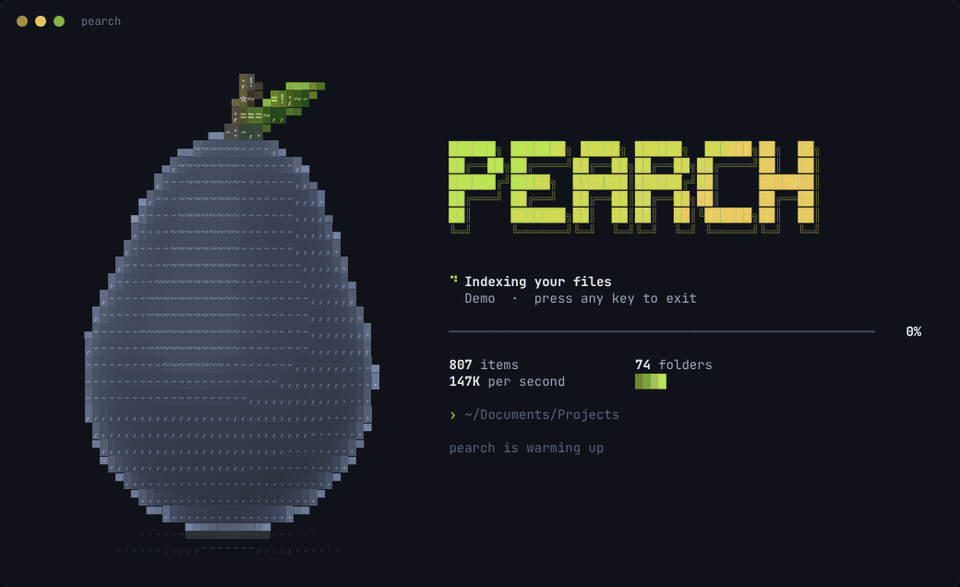
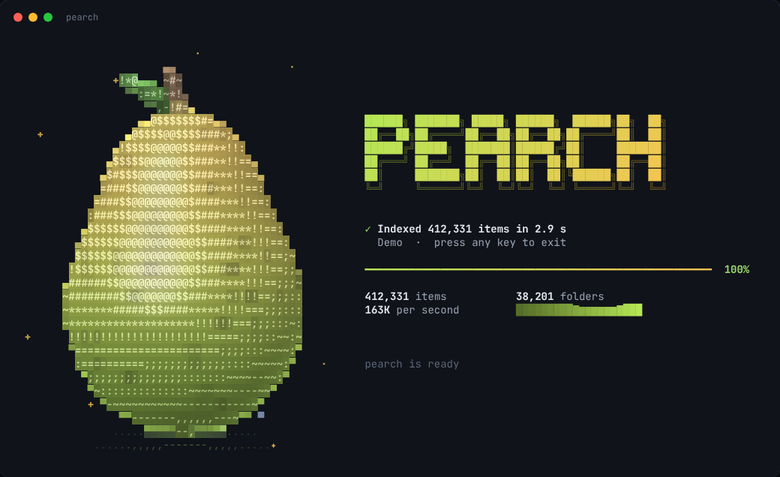

<p align="center">
  
</p>

<h1 align="center">pearch</h1>

<p align="center">
  <b>Instant file search for your terminal.</b><br>
  Press a hotkey, type a few letters, hit Enter. As easy as Windows search, and much faster.
</p>

<p align="center">
  
</p>

---

## Install

**Windows** (PowerShell, no admin needed):

```powershell
irm https://raw.githubusercontent.com/Hobmoves/pearch/main/install.ps1 | iex
```

**Linux / macOS**:

```sh
curl -fsSL https://raw.githubusercontent.com/Hobmoves/pearch/main/install.sh | sh
```

The installer downloads the latest release and installs it for your user. On Windows it also:

- adds pearch to your PATH;
- creates a Start Menu shortcut with the global hotkey **Ctrl+Alt+Space**;
- adds **Search with pearch** to the Explorer right-click menu.

It then shows a 30-second tour (`pearch tour`) and offers to open pearch. With no release for your platform, it builds from source instead (needs git, CMake and a C++20 compiler).

## Use it

1. **Open it.** Press **Ctrl+Alt+Space** anywhere (Windows), or run `pearch` in any terminal.
   The first launch indexes your files while a 3D pear fills up with juice.
2. **Type.** Results update on every keystroke, ranked like Windows search: exact names first, then names that start with what you typed, then the rest. Apps and things you open often float to the top.
3. **Act.** Press **Enter** to open, **Ctrl+O** to show it in Explorer, **Ctrl+Y** to copy the path.

| Key | Does |
|---|---|
| type | search (words in any order) |
| <kbd>↑</kbd> <kbd>↓</kbd> <kbd>PgUp</kbd> <kbd>PgDn</kbd> | move |
| <kbd>Enter</kbd> | open, then close pearch |
| <kbd>Ctrl</kbd>+<kbd>Enter</kbd> | open and keep pearch open |
| <kbd>Ctrl</kbd>+<kbd>O</kbd> | show in folder |
| <kbd>Ctrl</kbd>+<kbd>Y</kbd> | copy the full path |
| <kbd>Tab</kbd> | All → Files → Folders → Apps |
| <kbd>Ctrl</kbd>+<kbd>S</kbd> | sort: relevance, name, date, size |
| <kbd>Ctrl</kbd>+<kbd>R</kbd> | refresh the index now |
| <kbd>Esc</kbd> | clear the search, press again to quit |
| mouse | wheel scrolls, click selects, double-click opens |

With an empty search box you see **Recent**: what you opened through pearch, then your most recently changed files. The **Apps** tab with an empty box lists every app A–Z.

### Search syntax

| You type | You get |
|---|---|
| `q3 report` | names containing both words, in any order (a word may also match a parent folder) |
| `"q3 report"` | that exact phrase |
| `*.pdf` &nbsp; `report*.docx` | wildcards (`*.pdf` = every PDF, newest first) |
| `ext:pdf,docx` | by extension |
| `file:` &nbsp; `folder:` &nbsp; `app:` | only files / folders / apps |
| `in:work` &nbsp; `work\q3` | inside a folder / by path |
| `-draft` | leave out names containing "draft" |
| `size:>10mb` &nbsp; `size:empty` | by size (`>` `<`, kb/mb/gb, or empty/large/huge) |
| `modified:week` | changed today, yesterday, this week/month/year, or `3d`, `12h` |
| `vs code` | apps by their initials too: **V**isual **S**tudio **Code** |
| `qrtly` | close matches when nothing matches exactly: **q**ua**rt**er**ly** |

Matching ignores case and accents: `resume` finds `Résumé.pdf`.

### Commands

| Command | Does |
|---|---|
| `pearch` | open the search screen |
| `pearch q3 report` | open it with words already typed |
| `pearch -l q3 report` | print matches instead (automatic when piped: `pearch *.log \| more`) |
| `pearch --in D:\Work` | search inside one folder (works on folders outside the index too) |
| `pearch add D:\` | also index another folder or drive |
| `pearch remove D:\` | stop indexing it |
| `pearch locations` | what's indexed |
| `pearch index` | rebuild the index now |
| `pearch stats` | index size, age, and how pearch is using your hardware |
| `pearch tour` | the quick guide |
| `pearch install` / `uninstall [--purge]` | Windows integration on/off (`--purge` also deletes the index) |

By default pearch indexes your user folder (Desktop, Documents, Downloads, Pictures, ... even when they live on OneDrive or another drive) plus Start Menu apps. Like Windows search, it skips `AppData`. It also never looks inside `node_modules`, `.git` and similar folders, though the folders themselves still show up.

## Fast, and it uses your hardware

pearch keeps the whole index in memory as a few flat arrays. A search is one pass over the lower-cased, accent-free names, and that pass is split across every CPU core. Measured on a synthetic index of **1,000,000 files** on a small 4-vCPU cloud VM (`pearch_bench`):

| | pearch 0.1 (SQLite `LIKE`) | **pearch 1.0** |
|---|---|---|
| search ("report") | 318 ms | **3.8 ms** per keystroke, 8.9 ms cold |
| typical keystroke (median) | ~318 ms | **~4 ms** |
| load the index at startup | opens a database | **89 ms** (71 MB snapshot) |
| memory for 1M files | — | 84 MB |

How it adapts to your machine (see `pearch stats`):

- **CPU.** Searching uses every logical core: all 16 threads on an 8-core Ryzen 7. The substring scan picks **AVX2** at runtime when your CPU has it (32 bytes per step) and SSE2 otherwise, so one `.exe` runs everywhere. While you type, pearch only re-checks the previous matches instead of scanning everything again, and the best results are picked in parallel.
- **Drives.** Before indexing, pearch asks Windows what each drive is.
  - **NVMe:** up to 2× your thread count of parallel folder readers (32 on a 16-thread CPU), because NVMe handles many requests at once.
  - **SATA SSD:** one reader per thread.
  - **Hard disk:** 3 readers, because more would only make the disk head seek.
  
  Folders are read in large batches (`FIND_FIRST_EX_LARGE_FETCH`).
- **Background refresh.** The index refreshes itself in the background when it's older than 10 minutes. That refresh uses half the threads at Windows' low CPU *and* disk priority, so typing never stutters.
- **RAM.** With plenty of memory there are no limits; on machines under 4 GB pearch scans with fewer threads.
- **GPU.** pearch does not use the graphics card, and doing so would make it slower. The index is already in RAM, and one search reads it in a few milliseconds at memory speed. Copying it to the GPU and starting work there costs more than the whole search.

You can pin thread counts in `config.ini` (`scan-threads`, `search-threads`) if you like; `auto` is the default.

## The 3D pear

The indexing screen draws a pear in 3D using only text characters. The pear is a small math model: two blended spheres for the body, plus a stem and a leaf. Each character cell is lit with a key light, a rim light, specular highlights and soft shadowing, then drawn from the classic ` .,-~:;=!*#$@` ramp over a solid shaded background with 24-bit colour. As indexing progresses the pear fills with golden juice from the bottom up, with a wave on the surface, and it sparkles when it's done. Run `pearch --pear` to watch it on its own.

<p align="center"></p>

## Settings

Everything lives in one folder:

- `%LOCALAPPDATA%\pearch` on Windows;
- `~/.local/share/pearch` on Linux and macOS;
- or `$PEARCH_HOME` if you set it.

| File | What |
|---|---|
| `config.ini` | locations, skipped folders, refresh interval, thread counts (hand-editable) |
| `index.bin` | the index snapshot |
| `history.tsv` | what you opened, for ranking (stays on your machine) |

pearch never sends anything anywhere.

## Build from source

You need CMake 3.21+ and a C++20 compiler: Visual Studio 2022 or newer, GCC 11+, or Clang 14+. There are no other dependencies.

```sh
cmake --preset release
cmake --build --preset release
ctest --preset release            # 33 tests
./build/release/pearch_bench      # the benchmark above
```

On Windows the result is a single self-contained `pearch.exe` with its icon and manifest built in, so you can copy it anywhere. Running `.\install.ps1` from a clone builds and installs that clone.

Releases are built by GitHub Actions: pushing a tag such as `v1.0.0` publishes `pearch-windows-x64.exe`, `pearch-linux-x64` and `pearch-macos-arm64`/`-x64`, which the one-line installers download.

## Uninstall

```powershell
pearch uninstall --purge
```

This removes the Windows integration, the program, and (with `--purge`) the index. On Linux and macOS, run `pearch uninstall --purge` to delete the index, then delete `~/.local/bin/pearch`.
